<div align="center">


# Mi Negocio

**Stock, ventas y ganancias de tu kiosko, en tu teléfono y sin internet.**

Una app Android simple para llevar el inventario por lotes, vender escaneando códigos de barras
y saber cuánto ganas de verdad, sin crear cuentas y sin que tus datos salgan del teléfono.


</div>

---

## 📱 Capturas

| Inicio | Venta | Detalle del producto |
|:---:|:---:|:---:|
| 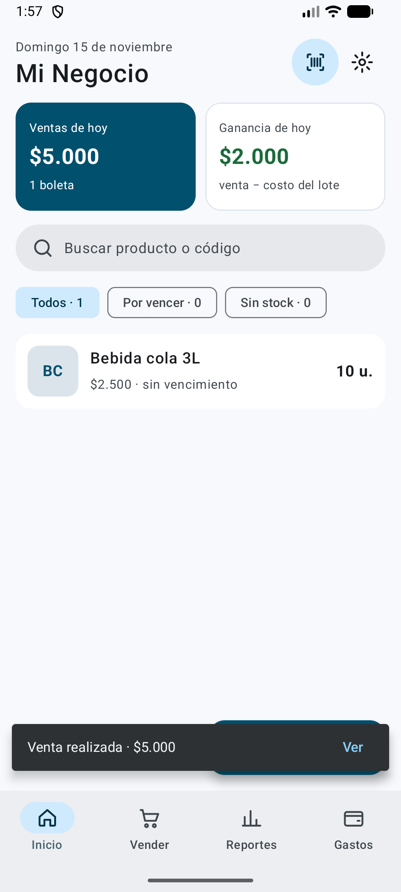 | 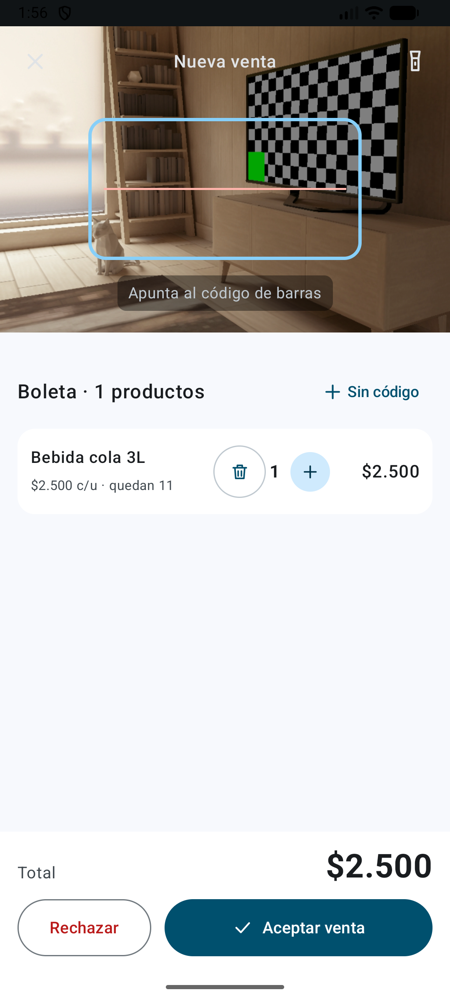 | 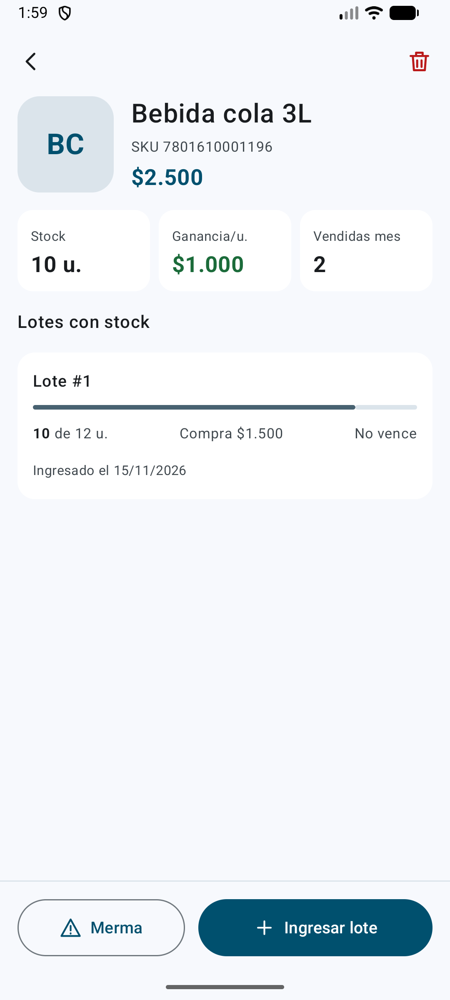 |
| **Reportes** | **Gastos** | **Tema oscuro** |
| 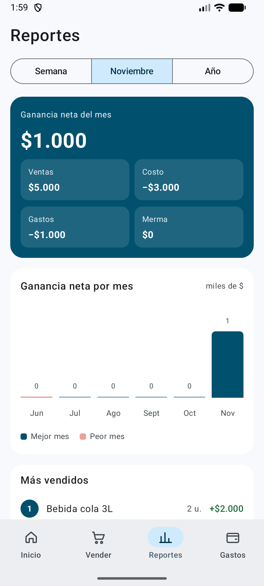 | 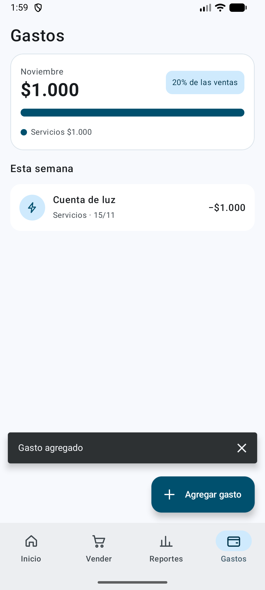 | 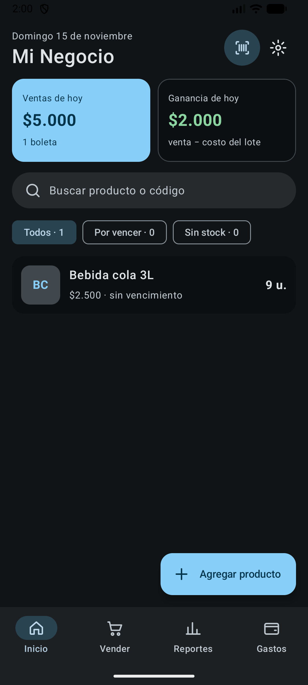 |

## 💡 El problema

Las apps de inventario suelen pedir una cuenta, una suscripción o conexión permanente.
Un kiosko de barrio solo necesita algo rápido: **anotar lo que compra, cobrar lo que vende y saber si al final del mes ganó o perdió**.
Mi Negocio hace exactamente eso y todo queda guardado en el propio teléfono.

## ✨ Funcionalidades

- **Productos**: nombre, precio de venta, código de barras (escaneado con la cámara) y foto opcional. Avisa si el producto ya existe y permite reactivar los eliminados.
- **Lotes con vencimiento**: cada compra se ingresa como un lote con su precio de compra, unidades y fecha de vencimiento.
- **Ventas con escáner**: apuntas la cámara al código y el producto se suma a la boleta. Los productos sin código se eligen de una lista.
- **Descuento FEFO**: al vender, el stock sale primero del lote que vence antes (*First Expired, First Out*).
- **Ventas seguras**: cada venta se guarda en una transacción. Si falta stock, no queda nada a medias.
- **Merma**: registra lo vencido, dañado o perdido, valorizado a precio de compra.
- **Gastos**: luz, arriendo, transporte, insumos… agrupados por categoría y por semana.
- **Reportes**: ganancia neta (ventas − costo − gastos − merma), gráfico de los últimos 6 meses y productos más vendidos.
- **Alertas**: productos por vencer y sin stock, con días de aviso configurables.
- **Respaldo**: exporta e importa la base de datos a un archivo (Descargas, Drive, pendrive…). Revisa que el archivo sea un respaldo válido antes de restaurarlo.
- **Tema claro y oscuro**, según el sistema o a elección.

## 🔒 Privacidad

- **Sin cuentas y sin internet**: la app ni siquiera tiene el permiso de internet (`INTERNET` se quita del manifiesto).
- El lector de códigos usa el modelo de ML Kit **incluido en la app**, así que funciona sin conexión.
- El único permiso que pide es la **cámara**, para escanear códigos y sacar fotos de productos.
- Todos los datos viven en una base SQLite dentro del almacenamiento privado de la app.

## 🛠️ Tecnologías

| Área | Herramienta |
|---|---|
| Lenguaje | Kotlin 2.3 |
| Interfaz | Jetpack Compose · Material 3 |
| Navegación | Navigation 3 |
| Base de datos | Room 2.8 (SQLite) con migraciones automáticas |
| Cámara y escáner | CameraX · ML Kit Barcode Scanning (modelo incluido) |
| Arquitectura | MVVM · repositorios · inyección de dependencias manual |
| Tests | JUnit 4 · Robolectric · kotlinx-coroutines-test |

## 🧱 Arquitectura

El proyecto separa la interfaz, las reglas del negocio y el acceso a datos (MVVM en capas):

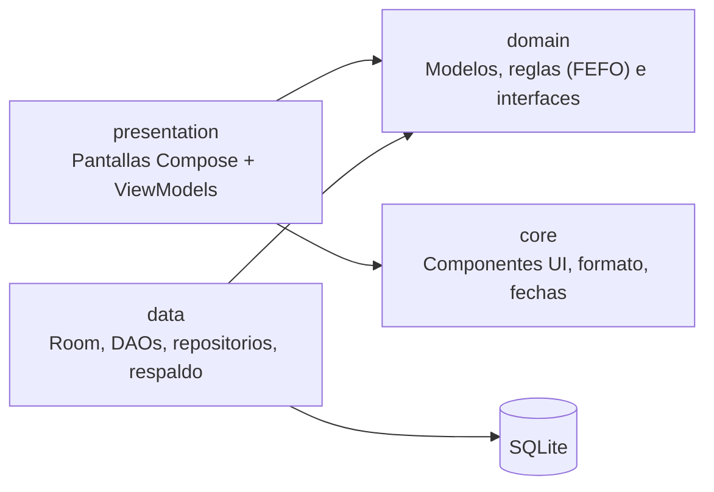

```
app/src/main/kotlin/cl/miproyecto/minegocio/
├── core/           # Componentes de UI reutilizables, íconos, escáner, utilidades
├── data/           # Entidades y DAOs de Room, repositorios, preferencias y respaldo
├── domain/         # Modelos del negocio, interfaces de repositorios y casos de uso (FEFO)
├── presentation/   # Pantallas y ViewModels: productos, lotes, ventas, merma, gastos, reportes...
└── ui/theme/       # Colores, tipografía y tema claro/oscuro
```

## 🗃️ Modelo de datos

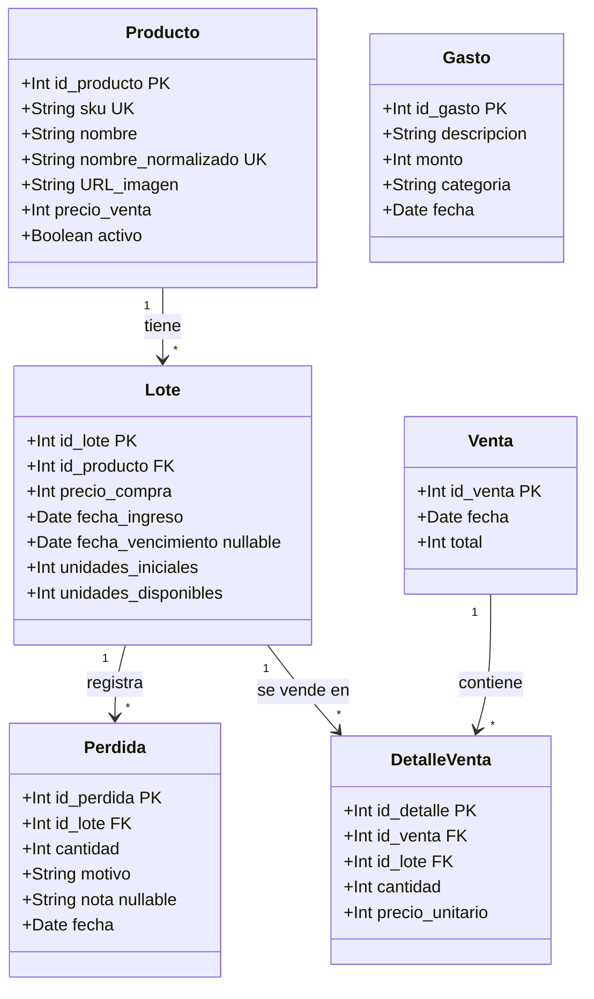

> La ganancia se calcula con el **precio de compra del lote** del que salió cada unidad,
> por eso cada línea de venta guarda el lote (`id_lote`) y no solo el producto.

## 🔄 Flujos principales

<details>
<summary><b>Registro de producto</b></summary>

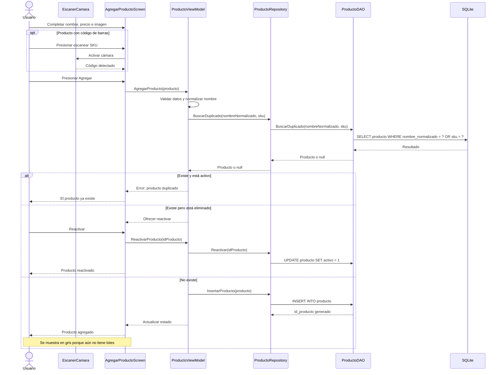
</details>

<details>
<summary><b>Ingreso de lotes</b></summary>

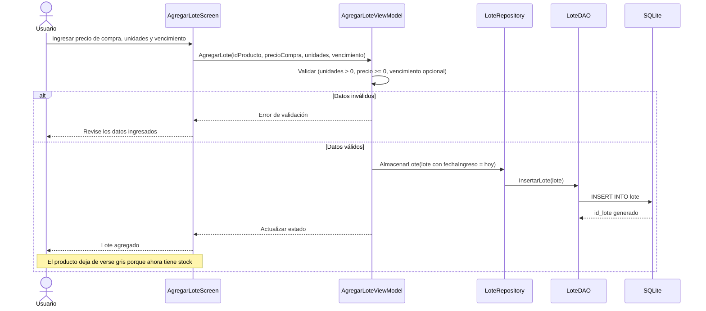
</details>

<details>
<summary><b>Venta con escaneo y descuento FEFO</b></summary>

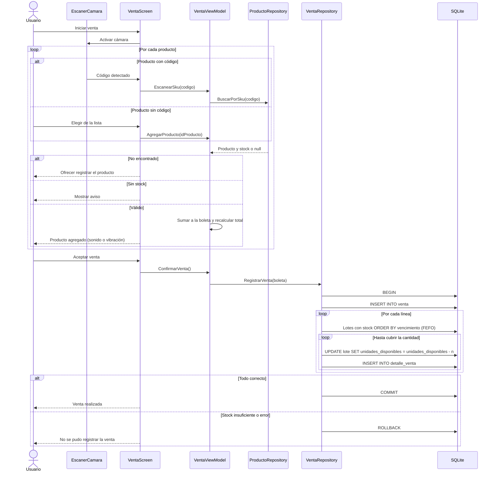
</details>

<details>
<summary><b>Merma</b></summary>

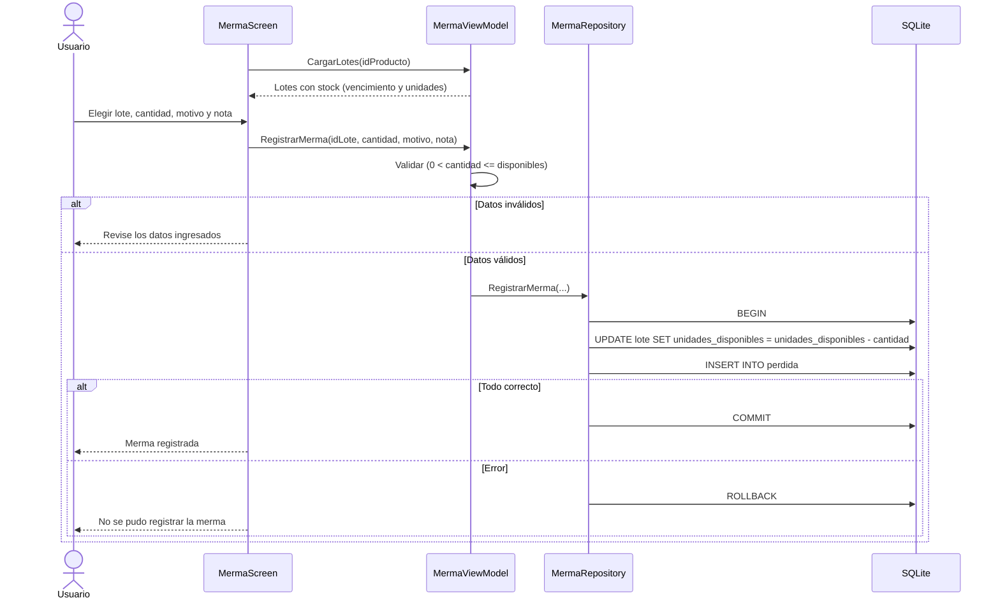
</details>

## 🚀 Cómo compilar

**Requisitos:** Android Studio (o JDK 17 y Android SDK 37) y un teléfono o emulador con Android 7.0 o superior.

```bash
git clone https://github.com/CokkeDev/Mi-Negocio.git
cd Mi-Negocio
./gradlew assembleDebug      # APK de prueba en app/build/outputs/apk/debug/
./gradlew testDebugUnitTest  # Ejecuta los tests
```

<details>
<summary><b>Generar un APK release firmado</b></summary>

1. Crea tu llave de firma (guárdala bien: sin ella no podrás actualizar la app instalada):

   ```bash
   keytool -genkeypair -v -keystore mi-negocio.jks -alias minegocio -keyalg RSA -keysize 2048 -validity 10000
   ```

2. Crea `keystore.properties` en la raíz del proyecto:

   ```properties
   storeFile=mi-negocio.jks
   storePassword=tu_contraseña
   keyAlias=minegocio
   keyPassword=tu_contraseña
   ```

3. Compila:

   ```bash
   ./gradlew assembleRelease   # app/build/outputs/apk/release/app-release.apk
   ```

`keystore.properties` y los archivos `.jks` están en `.gitignore` y **nunca deben subirse al repositorio**.
</details>

## 🧪 Tests

43 tests locales (se ejecutan en el computador con Robolectric, sin emulador):

| Área | Qué se verifica |
|---|---|
| Ventas | Descuento FEFO, total y ganancia por lote, rollback si falta stock |
| Merma y gastos | Descuento del lote, costo de la pérdida, listado y suma por categoría |
| Reportes | Ganancia neta, rangos de fechas, más vendidos, últimos 6 meses |
| Productos | Stock por lotes, próximo vencimiento, eliminar/reactivar, códigos únicos |
| Migraciones | Una base de datos de versiones anteriores (1 y 2) sube a la 3 sin perder datos |
| Respaldo | Solo acepta respaldos válidos de Mi Negocio |
| Utilidades | Reparto FEFO, formato de pesos, normalización de nombres |


<div align="center">

Hecho por [CokkeDev](https://github.com/CokkeDev)

</div>
