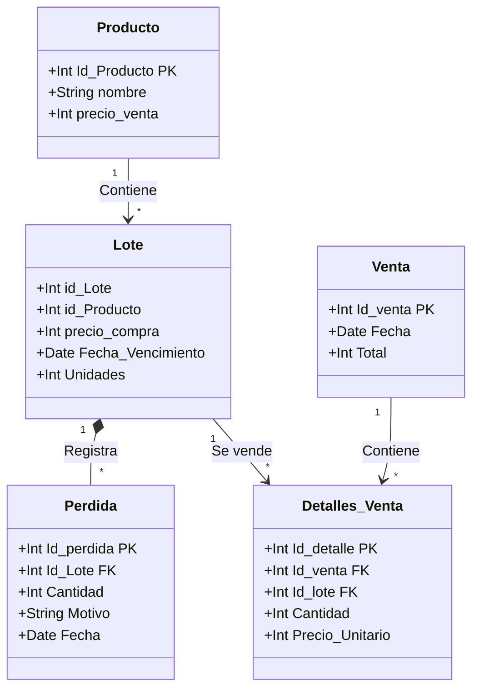

# Mi-Negocio
Crear un aplicación la cual pueda usarse de manera offline para mantener stock, ventas ganancias e historial del negocio de manera simple para el usuario.

# Stack tecnológico

- Kotlin lenguaje de desarrollo, este esta enfocado en Java pero para dispositivos Android.
- Sql lite para la base de datos.

# Arquitectura del proyecto

El proyecto utilizara la arquitectura de Modelo vista vista modelo para separar la interfaz de usuario de la lógica de negocio y de presentación.

las carpetas que tiene el proyecto esta enfocada de la siguiente manera:

- Core: funcionalidades comunes a toda la aplicación que no representan específicamente las reglas del negocio.
- Presentation: Aqui se agrega todo lo que va relacionado a la interfaz que el usuario visualizaria en la aplicación.
- Domain: Qué es lo que debe de hacer el negocio, lo que define como funciona.
- Data: cómo obtengo y guardo los datos.

# El MVP de la apliación

1.- Identificar el problema

2.- Seleccionar las funciones escenciales

No existe una aplicación simple donde se pueda mantener un registro del stock del kiosko y registrar las ganancias que se obtienen de manera que no tenga que registrar con una cuenta y que se mantenga todo de manera offline, las funciones que tiene la aplicación son:

Poder agregar productos que se venderan en el kiosko donde el usuario podra agregar, foto del producto, Precio de venta, Precio de compra, Nombre del producto, Fecha de vencimiento y stock disponible.

Eliminar productos, el usuario podra eliminar los porductos que agrego en caso de haber un error.

Vender producto, cuando seleciona la opción de vender se abrira una ventana donde se seleccionara la cantidad vendida y eso se le restara al stock, se le sumara la ganancias.

Merma, opción en caso de que el produto no se haya podido vender y se hecha a perder.

ver registros de ganacias, se mostrara los productos más vendidos, con las ganancias y los gastos realizados y los reportes de los meses con sus graficos representando los meses con mas ganancias y perdidas.

# Entindad relación BD

# Caso de uso
 

